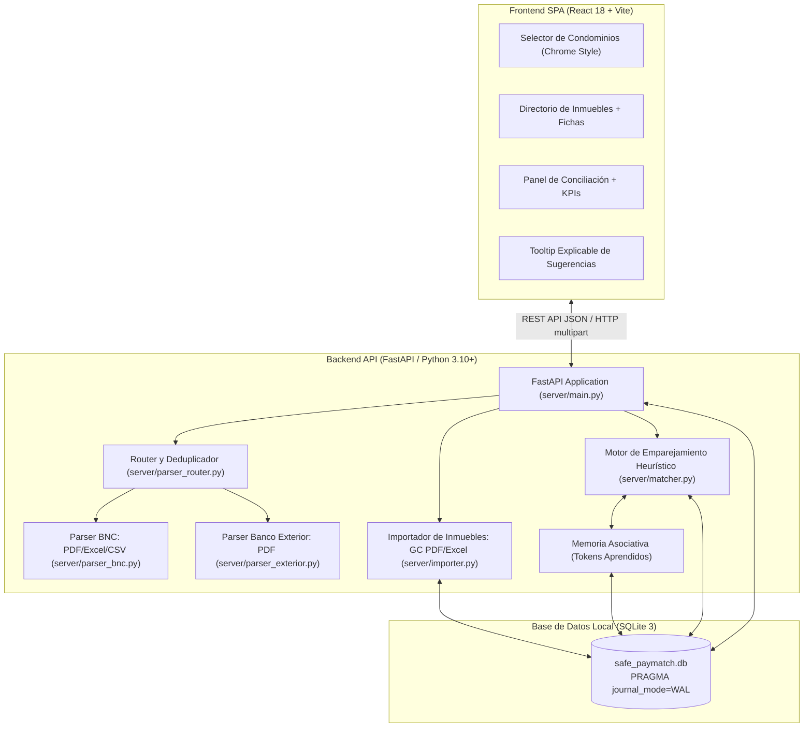
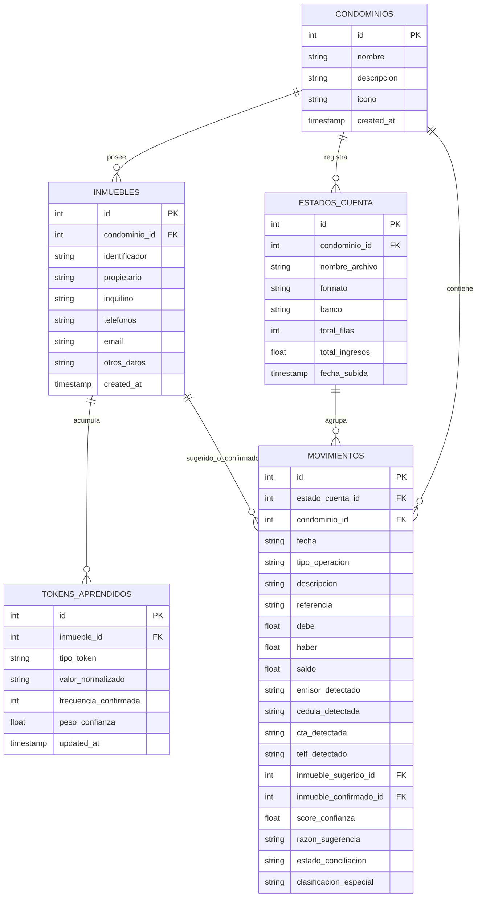

# Safe-PayMatch — Documentación Técnica de Arquitectura y Auditoría del Sistema

> **Versión del Documento:** 1.0  
> **Fecha de Elaboración:** Noviembre 2026  
> **Propósito:** Documento técnico exhaustivo para auditoría externa de código, refactorización y aseguramiento de calidad.

---

## 1. Resumen Ejecutivo y Propósito del Sistema

**Safe-PayMatch** es una solución local (on-premise / single-tenant) diseñada específicamente para la administración de condominios residenciales en Venezuela. Su objetivo central es automatizar y agilizar el proceso de **conciliación bancaria**: identificar a qué apartamento e inmueble corresponde cada transferencia bancaria o pago móvil que ingresa en los extractos de cuenta bancarios.

### 1.1 El Problema Operativo que Resuelve
1. **Extractos bancarios crudos con información fragmentaria**: Los bancos venezolanos (como BNC y Banco Exterior) proporcionan extractos donde el concepto del pago suele omitir el número de apartamento, mostrando únicamente una cédula, un teléfono de pago móvil, un número de cuenta origen, o un nombre parcial del ordenante.
2. **Discrepancia entre titular del inmueble y pagador real**: Con frecuencia, el titular catastral registrado en el condominio (ej. "Yosra") no es quien ejecuta la transferencia (ej. "Sandra Guédez", inquilina o familiar cuya cuenta realiza los pagos).
3. **Pérdida de tiempo en verificación manual**: La conciliación manual exige cruzar referencias bancarias, buscar números de cédula en fichas físicas o chats de WhatsApp, y verificar comisiones bancarias separadas.
4. **Falta de trazabilidad y privacidad**: Las soluciones en la nube suelen exponer datos financieros sensibles o requerir suscripciones costosas. Safe-PayMatch opera de forma 100% local sobre SQLite sin enviar información financiera a servidores externos.

---

## 2. Arquitectura General del Software

El sistema sigue una arquitectura cliente-servidor desacoplada que se distribuye empaquetada como una aplicación web de escritorio:



### 2.1 Estructura del Repositorio
```text
Safe-PayMatch/
├── run.py                          # Launcher inteligente con resolución de puertos
├── iniciar_app.bat                 # Script batch Windows para inicio en doble clic
├── server/                         # Código backend en Python
│   ├── __init__.py
│   ├── database.py                 # Conexión SQLite, DDL, WAL y pragmas
│   ├── models.py                   # Esquemas de validación Pydantic
│   ├── main.py                     # API REST, endpoints, exportador Excel
│   ├── matcher.py                  # Motor heurístico y memoria asociativa
│   ├── importer.py                 # Importación masiva (PDF GC y Plantilla Excel)
│   ├── parser_bnc.py               # Extracción BNC (PDF, Excel, correlación CIRJUR)
│   ├── parser_exterior.py          # Extracción Exterior (Oficial y Anotaciones Okular)
│   ├── parser_router.py            # Detección inteligente de banco y deduplicación
│   └── safe_paymatch.db            # Archivo SQLite de base de datos local
├── frontend/                       # Código frontend SPA en React + Vite
│   ├── package.json
│   ├── vite.config.js
│   ├── dist/                       # Build de producción servido por FastAPI
│   └── src/
│       ├── main.jsx
│       ├── App.jsx                 # Estado principal y barra superior
│       ├── api.js                  # Cliente fetch para todos los endpoints REST
│       └── components/
│           ├── CondominioSelector.jsx # Pantalla de condominios (estilo perfiles Chrome)
│           ├── InmueblesManager.jsx   # Directorio, CRUD y modal de tokens
│           ├── ConciliacionPanel.jsx  # Dropzone, KPIs, tabla interactiva, filtros
│           └── Tooltip.jsx            # Tooltip flotante con desglose de porcentaje
└── samples/                        # Extractos bancarios y fichas de prueba reales
```

---

## 3. Modelo de Datos y Persistencia (SQLite)

La persistencia se implementa mediante SQLite estándar en `server/safe_paymatch.db`.

### 3.1 Configuración de Concurrencia y Robustez (`server/database.py`)
- **`PRAGMA journal_mode = WAL;` (Write-Ahead Logging)**: Permite que múltiples lectores concurrentes lean datos sin bloquear escrituras, previniendo errores de `database is locked`.
- **`PRAGMA foreign_keys = ON;`**: Garantiza integridad referencial y borrado en cascada (`ON DELETE CASCADE`).
- **`timeout = 30.0`**: Bloqueo con espera máxima de 30 segundos antes de generar timeout operacional.

### 3.2 Diagrama Entidad-Relación



### 3.3 Descripción de Tablas

1. **`condominios`**: Entidad multi-inquilino lógica. Permite gestionar múltiples edificios residenciales de forma independiente.
2. **`inmuebles`**: Directorio de apartamentos (ej. `01-A`, `PH-B`). Almacena los datos canónicos conocidos (propietario, inquilino, teléfonos, correo y notas libres en `otros_datos`). Restricción `UNIQUE(condominio_id, identificador)`.
3. **`tokens_aprendidos`**: **Cerebro asociativo del sistema**. Cada vez que un usuario confirma un pago o se procesa un archivo histórico anotado, se descomponen y almacenan los datos del pagador (cuenta, cédula, teléfono, nombre o palabras clave del concepto) vinculados al `inmueble_id`. Restricción `UNIQUE(inmueble_id, tipo_token, valor_normalizado)`.
4. **`estados_cuenta`**: Representa los lotes de archivos de extractos bancarios cargados (metadatos del archivo, fecha de subida, totales calculados).
5. **`movimientos`**: Cada transacción individual extraída del banco. Registra el estado de conciliación (`'pendiente'` o `'confirmado'`), el inmueble sugerido por el algoritmo, el inmueble finalmente confirmado, el score de certeza (0% a 99%) y la explicación detallada.

---

## 4. Parsers Bancarios y Procesamiento de Extractos

La heterogeneidad de los extractos bancarios venezolanos requiere técnicas especializadas de extracción documental.

### 4.1 Router y Deduplicación (`server/parser_router.py`)

#### A. Detección Inteligente de Banco (`detect_bank_and_parse`)
Analiza el buffer binario del archivo:
- Si es `.xlsx`, `.xls` o `.csv` $\rightarrow$ procesa mediante `server/parser_bnc.py` (o Banco Exterior si las columnas lo indican).
- Si es `.pdf`, examina las dos primeras páginas vía `pdfplumber`:
  - Palabras clave como `"BANCO EXTERIOR"`, `"TRANSF REC V"`, `"9742"` $\rightarrow$ delega a `server/parser_exterior.py`.
  - Palabras clave como `"BANCO NACIONAL DE CREDITO"`, `"CIPOTR"`, `"CIRJUR"` $\rightarrow$ delega a `server/parser_bnc.py`.
  - Permite sobreescritura manual mediante el selector de banco de la interfaz.

#### B. Normalización de Referencias Bancarias (`normalize_ref`)
```python
def normalize_ref(ref: Any) -> str:
    s = str(ref or "").strip()
    clean = re.sub(r"^0+", "", s)
    return clean if clean else "0"
```
**Caso crítico resuelto:** En el Banco Exterior, la web oficial exporta referencias con hasta 12 ceros iniciales (`00000000000076581155`), mientras que un export de Excel o un PDF anotado muestra `76581155`. La normalización garantiza que ambas formas produzcan la misma clave unívoca.

#### C. Deduplicación por Riqueza de Datos (`deduplicate_movements`)
Al subir múltiples archivos solapados (ej. extracto del 2 de octubre, del 6 de octubre y mensual del 31 de octubre), el algoritmo:
1. Agrupa por clave unívoca: `(normalize_ref(referencia), round(haber, 2), round(debe, 2))`.
2. Para transacciones sin referencia (intereses o comisiones bancarias): `(fecha, descripcion, haber, debe)`.
3. Evalúa el **puntaje de riqueza** (`score_richness`):
   - $+1000$ pts si posee inmueble asignado previamente (anotación de usuario).
   - $+50$ pts si detectó cédula.
   - $+20$ pts si detectó emisor.
   - $+10$ pts si detectó cuenta.
   - Puntos adicionales por longitud del concepto descriptivo.
4. **Regla de conservación:** Siempre prevalece la fila con mayor enriquecimiento (anotada por el usuario), descartando copias en blanco o incompletas.

---

### 4.2 Parser de Banco Nacional de Crédito — BNC (`server/parser_bnc.py`)

1. **Formatos soportados**: PDF oficial del BNC (generado desde BNCNET), hojas de cálculo Excel (`.xlsx` / `.xls`) y archivos de valores separados por coma (`.csv`).
2. **Extracción por Expresiones Regulares**:
   - `TELF.: (\d{10,12})` $\rightarrow$ teléfono de pago móvil.
   - `CTA.: (\d{10,20})` o `CUENTA NRO. (\d{10,20})` $\rightarrow$ cuenta bancaria.
   - `(?:CED.:|DE:)\s*([VEJG]-?\d{6,9})` $\rightarrow$ cédula de identidad del ordenante.
   - `EMISOR: ([^,]+)` o `A NOMBRE DE: ([^,]+) DE LA CUENTA` $\rightarrow$ nombre del titular emisor.
3. **Algoritmo de Correlación de Comisiones (`correlate_comisiones`)**:
   - En el BNC, las operaciones interbancarias inmediatas (`CIPOTR`) registran el abono en una fila, y en la fila contigua inmediata registran la comisión del servicio (`CIRJUR`).
   - La fila de comisión contiene la cédula (`V-XXXXXXXX`) y el banco de origen que faltan en la fila del abono.
   - La función correlaciona ambas filas por contigüidad y transfiere la cédula y el banco al movimiento de abono principal.

---

### 4.3 Parser de Banco Exterior (`server/parser_exterior.py`)

El Banco Exterior presenta dos variantes documentales principales:

#### Variante 1: Extracto Oficial Web (Tablas PDF)
- Parseado mediante `pdfplumber` buscando la cabecera `["Día", "Referencia", "Descripción", "Cargos", "Abonos", "Saldos"]`.
- Determina automáticamente el mes y año del extracto a partir del texto de cabecera (`"Del DD/MM/AAAA Al DD/MM/AAAA"`).
- Extrae números de cédula estructurados mediante `\b([VEJG]-?\d{6,9})\b`.

#### Variante 2: PDF Exportado de Excel o con Anotaciones Libres (PyMuPDF / `fitz`)
- Maneja casos donde el usuario imprimió a PDF desde Excel o añadió notas con lectores como **Okular**, **Adobe Acrobat** o **Edge**.
- **Extracción de Anotaciones `FreeText`**: Inspecciona `page.annots()` para capturar textos flotantes donde el operador anotó manualmente el apartamento (ej. `02-D`, `11-B`, `Caney`).
- **Agrupación geométrica por coordenadas Y**: Agrupa palabras cuyos centros verticales difieran en menos de 4 puntos tipográficos, reconstruyendo las líneas de la tabla independientemente de la falta de bordes visibles.
- Si una anotación flotante coincide en coordenada $Y$ con una línea bancaria ($\Delta Y \le 8$ pt), se asocia de forma determinista como `inmueble_asignado_historico`.

---

## 5. Motor de Emparejamiento y Memoria Asociativa (`server/matcher.py`)

El motor de conciliación es un sistema híbrido que combina:
1. **Memoria asociativa acumulativa** (tokens aprendidos de conciliaciones pasadas).
2. **Reglas heurísticas y coincidencias exactas** (cédulas, cuentas, teléfonos).
3. **Similitud difusa de texto (Fuzzy Matching)** sobre nombres y propietarios.
4. **Búsqueda léxica en notas libres y correos**.

### 5.1 Matriz de Puntuación (Score de Confianza)

Para cada movimiento bancario, se evalúan todos los inmuebles del condominio aplicando las siguientes reglas aditivas:

| Criterio / Regla | Peso Ponderado | Condición de Activación |
| :--- | :---: | :--- |
| **Cuenta Bancaria Aprendida** | **95.0** | Los últimos 6+ dígitos de la cuenta coinciden con pagos confirmados previos del inmueble. |
| **Cédula de Identidad** | **90.0** | La cédula detectada coincide con un token confirmado en la memoria asociativa del inmueble. |
| **Teléfono de Pago Móvil** | **85.0** | El teléfono coincide con pagos anteriores o figura en la ficha del inmueble (`inmuebles.telefonos`). |
| **Emisor vs. Titular (Fuzzy)** | **75.0** | Similitud de tokens (`token_set_ratio` $\ge 85\%$) entre el emisor bancario y el Propietario o Inquilino. |
| **Emisor Parcial (Fuzzy)** | **45.0** | Similitud de tokens entre $65\%$ y $84\%$. |
| **Emisor Histórico Aprendido** | **70.0** | El emisor coincide ($\ge 80\%$) con un pagador alternativo confirmado en meses previos para ese apartamento. |
| **Mención Explícita del Apto** | **70.0** | El concepto contiene el identificador exacto del apartamento mediante expresiones regulares con límite de palabra (`\b02-D\b`, `\bPH-A\b`). |
| **Mención Parcial del Apto** | **60.0** | Coincidencia de los componentes del identificador (ej. `"apto"` y `"1A"` en `"Abono apto 1A"`). |
| **Notas / Correo (`otros_datos`)** | **65.0** | Una palabra clave del concepto/emisor figura en el campo `otros_datos` o `email` (ej. caso *"Sandra Guédez paga por Yosra"*). |
| **Alias o Términos Aprendidos** | **45.0** | Un término recurrente del concepto coincide con tokens de tipo `alias_concepto`. |

### 5.2 Clasificación de Conceptos Especiales
El motor inspecciona el texto normalizado del concepto:
- `"caney"` $\rightarrow$ Clasificación `"Caney"` (área social/churuata).
- `"salon"` o `"fiesta"` $\rightarrow$ Clasificación `"Salón de Fiesta"`.
- `"multa"` $\rightarrow$ Clasificación `"Multa"`.

### 5.3 Normalización y Stop Words
Para evitar falsos positivos provocados por términos comunes en los conceptos bancarios, se limpian acentos (descomposición canónica NFKD) y se eliminan más de 40 *stop words* bancarias (`"pago"`, `"abono"`, `"condominio"`, `"transferencia"`, `"banco"`, `"comision"`, `"saldo"`, etc.).

### 5.4 Formulación del Score Final y Umbrales
$$\text{Score Final} = \min\left(\sum \text{Reglas Cumplidas}, 99.0\right)$$
- **Score $< 30\%$**: Coincidencia insuficiente. No se sugiere inmueble (`inmueble_sugerido_id = null`).
- **$30\% \le \text{Score} < 70\%$**: Coincidencia tentativa. Se sugiere el apartamento pero requiere confirmación manual del operador.
- **$\text{Score} \ge 70\%$**: **Alta certeza**. Elegible para la función de **Confirmación en Lote con 1 Clic**.

### 5.5 Aprendizaje Continuo (`learn_from_confirmation`)
Cuando un usuario confirma un pago (o se carga un archivo histórico marcado como tal), se dispara la función de refuerzo asociativo:
```sql
INSERT INTO tokens_aprendidos (inmueble_id, tipo_token, valor_normalizado, frecuencia_confirmada, peso_confianza)
VALUES (?, ?, ?, 1, 1.0)
ON CONFLICT(inmueble_id, tipo_token, valor_normalizado) DO UPDATE SET
    frecuencia_confirmada = frecuencia_confirmada + 1,
    peso_confianza = MIN(peso_confianza + 0.2, 3.0),
    updated_at = CURRENT_TIMESTAMP;
```
De este modo, a medida que el operador utiliza el sistema durante semanas o meses, la tasa de sugerencias automáticas de alta certeza converge hacia más del 90%.

---

## 6. Módulo de Importación Masiva de Inmuebles (`server/importer.py`)

Permite inicializar el directorio de cualquier condominio en segundos a través de dos mecanismos:

### 6.1 Parser de Reportes de Propietarios "GC Gestión de Condominios" (PDF)
- Utiliza `pdfplumber` analizando coordenadas espaciales ($X, Y$) de la página.
- Delimita el cuerpo de datos ($80 \le Y \le 535$) ignorando membretes y pies de página.
- Detecta los identificadores en la columna izquierda ($X_0 < 80$) mediante la regex:
  `^(\d{1,2}-[A-Z0-9]{1,3}|PH-[A-Z0-9]{1,3}|[A-Z0-9]{1,4}-[A-Z0-9]{1,4})$`
- Segmenta por franjas horizontales de columna:
  - $78 \le X < 235$: Nombre del Propietario.
  - $235 \le X < 350$: Cédula de Identidad (se guarda en `otros_datos` para que el matcher la use).
  - $350 \le X < 435$: Teléfonos.
  - $435 \le X < 580$: Correo Electrónico.

### 6.2 Plantilla Excel Estándar (`openpyxl`)
- Endpoint `GET /api/inmuebles/plantilla-excel`: Genera y descarga al vuelo una plantilla `.xlsx` prediseñada con formato sobrio, columnas autoajustadas, filas de ejemplo instructivas y validación de campos obligatorios.
- Parser de Excel: Lee los registros del usuario e inserta o actualiza en la base de datos aplicando lógica de *upsert* basada en `(condominio_id, identificador)`.

---

## 7. Catálogo Completo de la API REST (`server/main.py`)

| Método | Ruta | Descripción / Parámetros | Respuesta Principal |
| :--- | :--- | :--- | :--- |
| `GET` | `/api/condominios` | Lista todos los condominios registrados. | `[CondominioResponse]` |
| `POST` | `/api/condominios` | Crea un nuevo condominio (`nombre`, `descripcion`, `icono`). | `CondominioResponse` |
| `DELETE` | `/api/condominios/{id}` | Elimina un condominio y en cascada todos sus datos asociados. | `{"status": "deleted"}` |
| `GET` | `/api/condominios/{id}/inmuebles` | Retorna los inmuebles del condominio con sus tokens aprendidos. | `[InmuebleResponse]` |
| `POST` | `/api/condominios/{id}/inmuebles` | Crea un inmueble individualmente. | `InmuebleResponse` |
| `PUT` | `/api/inmuebles/{id}` | Actualiza la ficha de un inmueble. | `{"status": "updated"}` |
| `DELETE` | `/api/inmuebles/{id}` | Elimina un inmueble. | `{"status": "deleted"}` |
| `GET` | `/api/inmuebles/plantilla-excel` | Descarga la plantilla XLSX para llenado masivo. | `StreamingResponse (.xlsx)` |
| `POST` | `/api/condominios/{id}/inmuebles/importar` | Importa archivo GC (PDF) o Plantilla (Excel). | Resumen: `creados`, `actualizados`. |
| `POST` | `/api/condominios/{id}/conciliar/upload` | Carga de 1 o múltiples archivos de extractos bancarios. | Lote procesado y lista de movimientos. |
| `GET` | `/api/condominios/{id}/conciliar/ultimo` | Carga el último estado de cuenta y sus transacciones activas. | Objeto estado de cuenta + movimientos. |
| `GET` | `/api/condominios/{id}/estados-cuenta` | Lista todos los lotes de extractos cargados para el condominio. | `[estados_cuenta]` |
| `GET` | `/api/estados-cuenta/{id}/movimientos` | Obtiene los movimientos de un extracto particular. | `[MovimientoResponse]` |
| `POST` | `/api/movimientos/confirmar` | Confirma o reasigna un movimiento a un apartamento. | `{"status": "confirmed"}` |
| `POST` | `/api/movimientos/confirmar-lote` | Confirma masivamente una lista de movimientos. | Conteo de confirmados y tokens aprendidos. |
| `GET` | `/api/estados-cuenta/{id}/exportar` | Genera y descarga el reporte final de conciliación en Excel. | `StreamingResponse (.xlsx)` |

---

## 8. Frontend y Diseño de Experiencia de Usuario (UI/UX)

La interfaz de usuario está construida en **React 18** empaquetada con **Vite**.

### 8.1 Lineamiento Estético ("White Signifier")
Inspirada en el manual de estilo provisto:
- **Paleta monocromática**: Fondo blanco puro (`#ffffff`), fondos secundarios sutiles (`rgba(0,0,0,0.015)` a `0.04`), bordes de 1 píxel extrafinos (`rgba(0,0,0,0.08)`).
- **Tipografía**: Fuentes serif para títulos de alto impacto, Segoe UI / Inter para textos de lectura e interfaz, y Geist Mono / fuentes monoespaciadas para montos, referencias y códigos.
- **Micro-interacciones y accesibilidad**: Cero recarga de página, animaciones de entrada fluidas, *drag & drop* con *feedback* visual de borde discontinuo.

### 8.2 Componentes Principales

1. **`CondominioSelector.jsx`**:
   - Inspirado en la pantalla de selección de usuarios de Google Chrome.
   - Tarjetas rectangulares apiladas en cuadrícula que priorizan el nombre del condominio y el acceso con 1 clic.
   - Modal de creación y borrado seguro con confirmación explícita.
2. **`InmueblesManager.jsx`**:
   - Directorio tabulado con búsqueda rápida por apartamento, propietario, cédula o teléfono.
   - Modal para importar en lote (GC Gestión de Condominios o Plantilla Excel).
   - Modal de inspección de la **Memoria Asociativa**: permite auditar exactamente qué cédulas, cuentas y teléfonos ha aprendido el sistema para un apartamento específico.
3. **`ConciliacionPanel.jsx`**:
   - Dropzone con soporte nativo de arrastrar múltiples archivos simultáneamente.
   - Selector inteligente de banco (Auto-detectar, BNC, Exterior).
   - Checkbox de "Archivo histórico" (para aprender de asignaciones previas).
   - Barra de KPIs en tiempo real: Total Ingresos (Bs.), Pagos Conciliados, Sugerencias de Alta Certeza listas, y Banco Detectado.
   - Botón de **Confirmación en Lote** para sugerencias con $\ge 70\%$ de confianza.
   - Tabla interactiva con filtros: *Todos*, *Solo Ingresos (Haber)*, *Pendientes*, *Confirmados*, y búsqueda en tiempo real.
   - Selectores inline para cambiar o asignar apartamentos y conceptos especiales (*Caney*, *Salón de Fiesta*, *Multa*).
   - Botón para exportar el resultado a Excel.
4. **`Tooltip.jsx`**:
   - Componente flotante que se activa al pasar el ratón (*mouseover*) sobre el icono de información o porcentaje de coincidencia.
   - Desglosa de forma transparente las razones lógicas del algoritmo (ej. *"Cédula V-19622304 coincide con pagador habitual registrado"*, *"Concepto menciona explícitamente el inmueble 02-D"*).

---

## 9. Launcher y Despliegue en Windows (`run.py` / `iniciar_app.bat`)

Para garantizar que un usuario de oficina sin conocimientos técnicos pueda ejecutar el programa sin fricción:

1. **`iniciar_app.bat`**: Script de doble clic que invoca el entorno Python local.
2. **`run.py` (Controlador de arranque inteligente)**:
   - **Detección y liberación de puertos (`free_port`)**: Si el puerto 8000 está ocupado por una instancia previa huérfana de Python, consulta `netstat` y finaliza automáticamente el proceso colgado antes de fallar con `Errno 10048`.
   - **Fallback dinámico**: Si no puede liberar el puerto 8000, escala automáticamente al puerto libre siguiente (8001, 8002, etc.).
   - **Apertura de navegador automática**: Inicia un hilo en segundo plano que abre `http://localhost:<puerto>` en el navegador predeterminado del sistema.
   - **Servidor Web Integrado**: FastAPI monta los archivos compilados de React (`frontend/dist`) como estáticos en la raíz `/`, sirviendo la interfaz y los endpoints REST desde el mismo puerto sin requerir servidores Node.js adicionales en ejecución.

---

## 10. Guía de Auditoría de Código y Oportunidades de Refactorización

Para la empresa auditora externa que revisará la base de código, se destacan los siguientes puntos de interés:

### 10.1 Puntos Fuertes de la Implementación
- ✅ **Alineación con la privacidad**: Toda la información y el cálculo corren 100% en local. No hay llamadas a APIs externas ni filtración de datos financieros o personales de los copropietarios.
- ✅ **Memoria asociativa eficiente**: La tabla `tokens_aprendidos` utiliza restricciones `UNIQUE` y cláusulas `ON CONFLICT DO UPDATE` nativas de SQLite, garantizando atomicidad y rendimiento constante sin importar el volumen de datos.
- ✅ **Resiliencia ante solapamiento de extractos**: La deduplicación cross-batch y la normalización de referencias evitan de forma determinista la inserción de pagos redundantes.
- ✅ **Explicabilidad del algoritmo**: Cada sugerencia viene respaldada por un desglose en lenguaje natural, evitando el efecto de "caja negra".

### 10.2 Áreas Sugeridas para Auditoría y Mejoras Futuras

1. **Desacoplamiento de Base de Datos y Patrón Repositorio**:
   - *Estado actual:* Algunas consultas SQL complejas se encuentran embebidas directamente en los manejadores de rutas en `server/main.py`.
   - *Recomendación:* Extraer las operaciones CRUD y de consulta a un módulo `server/repository/` o servicios dedicados (`conciliacion_service.py`, `inmuebles_service.py`), dejando `main.py` enfocado exclusivamente en la definición de rutas HTTP.
2. **Cobertura de Pruebas Automatizadas (Unit Tests & Pytest)**:
   - *Estado actual:* Se cuenta con archivos de prueba reales en `samples/` y pruebas en tiempo de desarrollo.
   - *Recomendación:* Crear una suite formal de pruebas unitarias bajo `tests/` con `pytest` que valide:
     - Casos límite de `parse_amount` (números negativos, formatos europeos vs venezolanos).
     - Casos de `deduplicate_movements` con referencias idénticas con/sin ceros a la izquierda.
     - Pruebas de integración del `matcher.py` simulando variaciones de nombres y cédulas.
3. **Manejo Centralizado de Excepciones**:
   - *Estado actual:* Bloques `try/except` puntuales en cada parser.
   - *Recomendación:* Implementar un `exception_handler` global en FastAPI para capturar errores de formato documental y emitir respuestas JSON estructuradas con códigos de error amigables para el usuario final.
4. **Gestión de Backups de Base de Datos**:
   - *Recomendación:* Incorporar un botón en la interfaz o un comando programado que genere una copia de seguridad timestamped de `safe_paymatch.db` (utilizando la API `sqlite3.backup` nativa de Python).
5. **Paginación en Tabla de Conciliación**:
   - *Estado actual:* La tabla carga todos los movimientos del extracto en memoria (probado con hasta 250 filas sin problemas de rendimiento gracias a React virtual DOM).
   - *Recomendación:* Si en el futuro se manejan condominios masivos con más de 1.000 pagos por extracto, implementar virtualización de filas con `@tanstack/react-virtual` o paginación por bloques de 50 registros.
